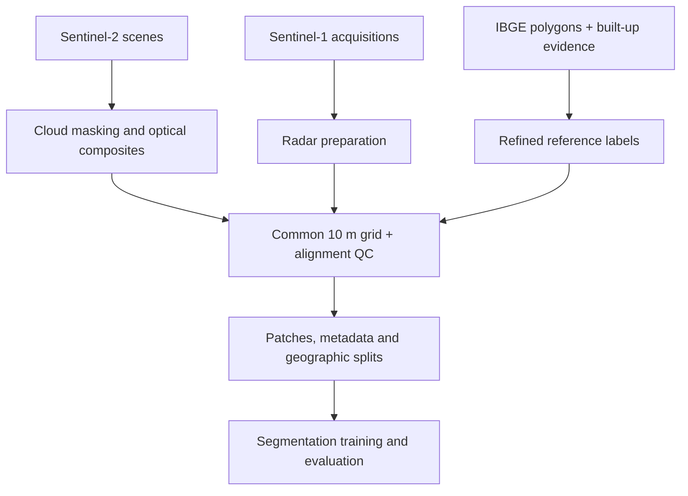

# Brazil favela mapping — IRD project overview

A multimodal remote-sensing research project developed during my master's research at **IRD, UMR ESPACE-DEV**. The objective was to map favelas in Brazil using aligned **Sentinel-1 radar**, **Sentinel-2 optical imagery**, and refined settlement labels.

This page is the entry point to the four processing repositories. This repository itself contains the early polygon-cleaning and GHSL label-refinement work.

## Research outcome and availability

The wider research produced a benchmark covering **26 Brazilian cities** with **12,699 aligned Sentinel-1/2 patches** on common **10 m grids**, and segmentation experiments with **CROMA, SMARTIES, and TerraMind**. IBGE settlement boundaries were refined using built-up and land-cover evidence, including GHSL, MapBiomas, ESA WorldCover, and WSF.

The final TerraMind-based segmentation experiment used a residual-ASPP decoder and achieved **IoU 0.8151 / Dice 0.8981 on the same-city test protocol**. These are thesis results, not an unseen-city generalisation score. The public repositories below do not yet constitute a complete release of the final TerraMind experiment.

**Dataset release is pending.** Satellite data, final benchmark files, and trained checkpoints are not bundled here. No publication acceptance is implied.

[Read the master's thesis](https://drive.google.com/file/d/1xght2L_ex5_-7mI3n93vxPnZ8XtSCrH3/view?usp=sharing) for the experimental context and evaluation protocols.

## Repository map

| Stage | Repository | Contents |
| --- | --- | --- |
| 1. Optical acquisition and compositing | [cloud_removing_pipeline](https://github.com/Mahmoud-AboShukr/cloud_removing_pipeline) | Sentinel-2 scene selection, cloud/shadow masking, compositing, and coverage diagnostics |
| 2. Radar acquisition | [sentinel1_download_pipeline](https://github.com/Mahmoud-AboShukr/sentinel1_download_pipeline) | Sentinel-1 acquisition workflow and supporting documentation |
| 3. Reference-label preparation | [favela-dataset-pipeline](https://github.com/Mahmoud-AboShukr/favela-dataset-pipeline) — this repository | Polygon cleaning, Brasília pilot, GHSL clipping, and label-refinement scripts |
| 4. Harmonisation and experiments | [brazil-favela-s1-s2-postprocessing](https://github.com/Mahmoud-AboShukr/brazil-favela-s1-s2-postprocessing) | Common-grid alignment, label rasterisation, QC, patch metadata, geographic splits, and experimental model code |



## What is implemented here

- Polygon cleaning: [subtask1_clean_polygons.py](src/labels/subtask1_clean_polygons.py).
- Brasília extraction: [subtask1_extract_brasilia.py](src/labels/subtask1_extract_brasilia.py).
- GHSL inspection and clipping: [src/ghsl](src/ghsl).
- Pilot label refinement: [subtask3_refine_brasilia_with_ghsl.py](src/labels/subtask3_refine_brasilia_with_ghsl.py).
- Processing decisions and methods: [docs](docs).

Some scaffold files, including the generic CLI, patch-building modules, and test files, are empty placeholders. Their presence does not indicate an implemented or tested end-to-end pipeline. Older notes describing 512 × 512 pilot patches concern that development stage, not necessarily the final benchmark configuration.

## Start with the label-preparation pilot

```bash
git clone https://github.com/Mahmoud-AboShukr/favela-dataset-pipeline.git
cd favela-dataset-pipeline
python -m venv .venv
# Linux/macOS: source .venv/bin/activate
# Windows PowerShell: .venv\Scripts\Activate.ps1
python -m pip install -r requirements.txt
python src/labels/subtask1_clean_polygons.py "/path/to/favelas.shp"
```

Supply the original shapefile bundle and GHSL rasters locally. Review [config/config.yaml](config/config.yaml) and each script's path settings before running the Brasília and refinement steps; these are research scripts, not a single portable CLI. Expected pilot products include cleaned GeoPackages, GHSL clips, and binary masks.

Keep raw imagery and intermediate rasters outside Git. Inspect masks over imagery in QGIS and retain the processing settings and QC evidence with each local dataset version.
